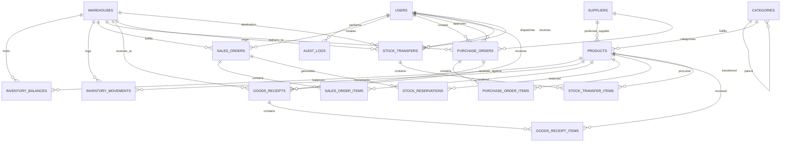

# Database Architecture & Entity Relationship Specification

## Retail Inventory Management System (RIMS) — Phase 2

This document provides the complete relational database design, table definitions, constraints, enumerations, and migration strategy implemented in Phase 2 using **PostgreSQL 16** and **Drizzle ORM**.

---

## 1. Entity-Relationship Diagram



---

## 2. Table Specifications & Constraints

### 2.1 Foundational Tables

| Table                 | Primary Key | Key Columns & Types                                                                                                                                                                 | Constraints & Invariants                                                                                                                                                                                                                          |
| :-------------------- | :---------- | :---------------------------------------------------------------------------------------------------------------------------------------------------------------------------------- | :------------------------------------------------------------------------------------------------------------------------------------------------------------------------------------------------------------------------------------------------ |
| `users`               | `id (UUID)` | `email (TEXT)`, `password_hash (TEXT)`, `role (ENUM)`, `is_active (BOOLEAN)`                                                                                                        | `UNIQUE(email)`. Roles: `ADMIN`, `INVENTORY_MANAGER`, `WAREHOUSE_STAFF`, `SALES_REP`, `AUDITOR`.                                                                                                                                                  |
| `categories`          | `id (UUID)` | `code (TEXT)`, `name (TEXT)`, `parent_id (UUID FK)`                                                                                                                                 | `UNIQUE(code)`, self-referential `parent_id` with `ON DELETE RESTRICT`.                                                                                                                                                                           |
| `suppliers`           | `id (UUID)` | `code (TEXT)`, `name (TEXT)`, `email (TEXT)`, `phone (TEXT)`                                                                                                                        | `UNIQUE(code)`. Status active flag defaults to `true`.                                                                                                                                                                                            |
| `products`            | `id (UUID)` | `sku (TEXT)`, `barcode (TEXT)`, `category_id (UUID FK)`, `cost_price (NUMERIC 12,4)`, `selling_price (NUMERIC 12,4)`                                                                | `UNIQUE(sku)`, `UNIQUE(barcode)`. `CHECK(cost_price >= 0)`, `CHECK(selling_price >= 0)`, `CHECK(reorder_point >= 0)`.                                                                                                                             |
| `warehouses`          | `id (UUID)` | `code (TEXT)`, `name (TEXT)`, `is_active (BOOLEAN)`                                                                                                                                 | `UNIQUE(code)`.                                                                                                                                                                                                                                   |
| `inventory_balances`  | `id (UUID)` | `warehouse_id (UUID FK)`, `product_id (UUID FK)`, `on_hand_qty (NUMERIC 12,2)`, `reserved_qty (NUMERIC 12,2)`, `quarantined_qty (NUMERIC 12,2)`, `available_qty (GENERATED STORED)` | `UNIQUE(warehouse_id, product_id)`. `available_qty GENERATED ALWAYS AS (on_hand_qty - reserved_qty - quarantined_qty) STORED`. `CHECK(on_hand_qty >= 0)`, `CHECK(reserved_qty >= 0)`, `CHECK(quarantined_qty >= 0)`, `CHECK(available_qty >= 0)`. |
| `inventory_movements` | `id (UUID)` | `warehouse_id (UUID FK)`, `product_id (UUID FK)`, `movement_type (ENUM)`, `quantity (NUMERIC 12,2)`, `balance_before`, `balance_after`, `reference_type`, `reference_id`            | Append-only ledger. `CHECK(quantity <> 0)`. Captures actor, reason, timestamps, and balance snapshots.                                                                                                                                            |

### 2.2 Supporting Domain Tables

| Table                  | Primary Key | Key Columns & Types                                                                                                         | Constraints & Invariants                                                                                         |
| :--------------------- | :---------- | :-------------------------------------------------------------------------------------------------------------------------- | :--------------------------------------------------------------------------------------------------------------- |
| `sales_orders`         | `id (UUID)` | `order_number (TEXT)`, `warehouse_id (UUID FK)`, `status (ENUM)`, `total_amount (NUMERIC 12,4)`                             | `UNIQUE(order_number)`. Single-warehouse order allocation. `CHECK(total_amount >= 0)`.                           |
| `sales_order_items`    | `id (UUID)` | `sales_order_id (UUID FK)`, `product_id (UUID FK)`, `quantity`, `unit_price`, `line_total`                                  | `ON DELETE CASCADE` with parent order. `CHECK(quantity > 0)`, `CHECK(unit_price >= 0)`.                          |
| `stock_reservations`   | `id (UUID)` | `sales_order_id (UUID FK)`, `warehouse_id (UUID FK)`, `product_id (UUID FK)`, `reserved_qty`, `status (ENUM)`               | `CHECK(reserved_qty > 0)`. Status: `ACTIVE`, `FULFILLED`, `RELEASED`.                                            |
| `purchase_orders`      | `id (UUID)` | `po_number (TEXT)`, `supplier_id (UUID FK)`, `destination_warehouse_id (UUID FK)`, `status (ENUM)`                          | `UNIQUE(po_number)`. Lifecycle: `DRAFT`, `SUBMITTED`, `APPROVED`, `PARTIALLY_RECEIVED`, `RECEIVED`, `CANCELLED`. |
| `purchase_order_items` | `id (UUID)` | `purchase_order_id (UUID FK)`, `product_id (UUID FK)`, `quantity_ordered`, `quantity_received`, `unit_cost`                 | `CHECK(quantity_ordered > 0)`, `CHECK(quantity_received >= 0)`.                                                  |
| `goods_receipts`       | `id (UUID)` | `receipt_number (TEXT)`, `purchase_order_id (UUID FK)`, `warehouse_id (UUID FK)`, `idempotency_key (TEXT)`                  | `UNIQUE(receipt_number)`, `UNIQUE(idempotency_key)`. Supports safe idempotent network retries.                   |
| `goods_receipt_items`  | `id (UUID)` | `goods_receipt_id (UUID FK)`, `product_id (UUID FK)`, `quantity_received`, `unit_cost`                                      | `CHECK(quantity_received > 0)`, `CHECK(unit_cost >= 0)`.                                                         |
| `stock_transfers`      | `id (UUID)` | `transfer_number (TEXT)`, `source_warehouse_id (UUID FK)`, `destination_warehouse_id (UUID FK)`, `status (ENUM)`            | `UNIQUE(transfer_number)`. `CHECK(source_warehouse_id <> destination_warehouse_id)`.                             |
| `stock_transfer_items` | `id (UUID)` | `stock_transfer_id (UUID FK)`, `product_id (UUID FK)`, `quantity`                                                           | `CHECK(quantity > 0)`.                                                                                           |
| `audit_logs`           | `id (UUID)` | `actor_id (UUID FK)`, `action (TEXT)`, `entity_type (TEXT)`, `entity_id (TEXT)`, `old_values (JSONB)`, `new_values (JSONB)` | Indexed on actor, entity, action, and timestamp.                                                                 |

---

## 3. Stock Invariants & Calculation Rules

The core inventory balance invariant is enforced at the database level via a **PostgreSQL Generated Stored Column**:

$$\text{available\_qty} = \text{on\_hand\_qty} - \text{reserved\_qty} - \text{quarantined\_qty}$$

- **Zero-Drift Guarantee:** Because `available_qty` is declared as `GENERATED ALWAYS AS (...) STORED`, it cannot be manually set or drifted by application code.
- **Negative Balance Prevention:** Table check constraint `CHECK (available_qty >= 0)` guarantees that an over-reservation or quarantine hold that exceeds unreserved on-hand stock will fail atomically with a PostgreSQL constraint violation.

---

## 4. Migration Execution & Verification

To run migrations against your target PostgreSQL database:

```bash
# Generate SQL migrations from schema
npm run db:generate

# Apply pending migrations
npm run db:migrate
```

To verify database constraints and integrity:

```bash
npm run test
```
